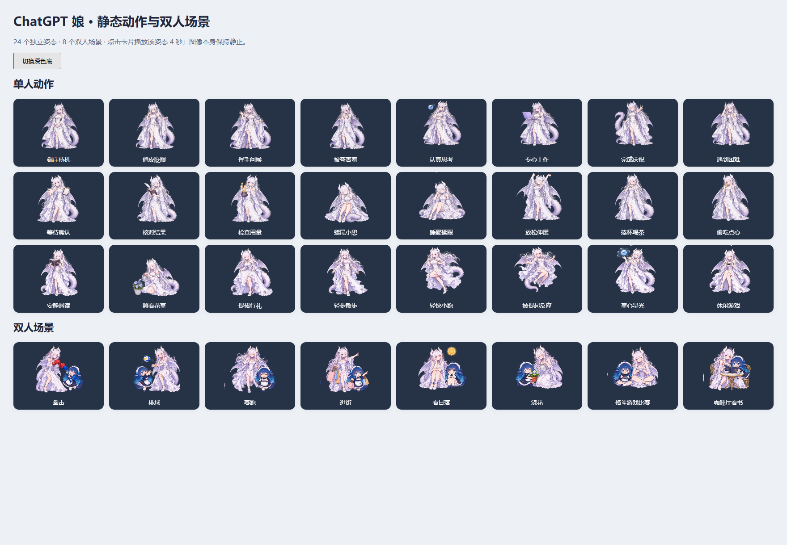

# DeepSeek & ChatGPT Desktop Pet

独立桌宠项目：大肥鱼、鲸鱼娘、ChatGPT 娘，共用交互引擎和角色包接口，可在 DeepSeek Harness（DSH）或独立 Electron 桌面窗口中运行。

**此仓库只包含桌宠。** 从 [原屏幕合并项目](https://github.com/JoenardoQ/Deepseek-and-ChatGPT-Pet-and-JonsboAIO) 提取，不包含设备驱动、USB 通信、屏幕推流、Python worker 或设备接管功能。

## 这一版的内容

| 角色 / 场景 | 资源 | 交互方式 |
| --- | --- | --- |
| 大肥鱼 `fish` | 保留原 106 个 WebM 动作 | 原动作目录、拖拽、点击、移动、睡眠、工作状态 |
| 鲸鱼娘 `whale` | 保留原 8 个 WebM 状态 | 共用交互引擎，按语义映射状态 |
| ChatGPT 娘 `chatgpt` | **24 个静态姿势**，存于 3 张透明 PNG 图集 | 状态切图；拖拽、移动和点击缩放仍然有效 |
| 双人互动 | **8 个静态场景**，存于 1 张透明 PNG 图集 | 两个宿主同时在线且角色匹配时显示 |

ChatGPT 的视频/GIF 播放分支和旧动作媒体不在本仓库中。原 107 个细分动作标识映射到 24 个语义姿势；这不是 107 张独立新图。计时只决定动作何时结束或窗口怎样移动，不连续解码图片帧。



动作与图像制作顺序：**参考两个 DeepSeek 桌宠 → 定义动作类型 → 编写每张图集的 prompt → 生成透明 PNG → 检查浅色/深色背景和真实窗口**。详细记录见 [动作设计](docs/chatgpt-actions.md)、[动作及 prompts](art-source/action-plan.json)、[旧动作映射](art-source/legacy-action-map.json)、[制作溯源](art-source/generation.json)。

## Windows 启动

需要 Node.js **24 LTS**（运行最低要求 22.12）。仓库包含构建后的 JS；首次启动按需安装两个 Electron 下载依赖，并准备 Electron，需要网络。

```powershell
git clone https://github.com/JoenardoQ/Deepseek-and-ChatGPT-Pet.git
cd Deepseek-and-ChatGPT-Pet
npm run pet -- wake
npm run pet -- state thinking "正在整理思路"
npm run pet -- status
npm run pet -- stop
```

也可以双击 `start-pet.cmd` / `stop-pet.cmd`。首次启动可能需等待 Electron 下载。状态命令报告进程启动情况；确认窗口出现才代表桌面显示成功。

右键桌宠可切换三种角色、选动作、设置桌面行为及双人场景。配置与日志默认保存在 `%LOCALAPPDATA%\DesktopPet`；不复用屏幕版配置。默认桥接端口 `19420`，内部桌宠服务端口 `19421`。可用 `PET_DATA_DIR`、`DSH_HOME`、`PET_PORT` 和 `DSH_PET_ELECTRON_PATH` 指定隔离目录、端口及已有 Electron。

独立窗口默认关闭会调用模型的碎碎念。需要自由聊天时，由宿主提供有效的模型连接；本项目不内置凭据。

## DSH 与本地 MCP

- **DSH**：本项目保留根包的 `dsh.bundle`、client 导出和 `cordis.patch.yml`，可通过 DSH 的 Git 插件安装入口安装此仓库。开启“桌面显示”后，角色菜单使用同一份 PetPack 注册表。此版的真实 DSH 应用安装尚需在目标版本上验收。
- **Codex / 支持本地 MCP 的客户端**：仓库提供根 `plugin.json`、`mcp.json` 与 Codex 兼容 manifest。将本仓库作为本地插件源加载，或配置本地 stdio 命令 `node <仓库绝对路径>/dsh-pet/bridge/mcp.mjs`。运行环境需要本机 Node。
- MCP 提供 `wake_pet`、`set_pet_state`、`hide_pet`、`shutdown_pet`、`pet_status`。插件加载时默认显示桌宠，设置 `PET_AUTOSTART=0` 可改为显式唤起。插件会话断开会释放自己的控制租约。
- 双人场景需要 DSH 与独立宿主各自的真实心跳；安装文件或多个 MCP 会话不会被误认为两只在线桌宠。当前场景适配大肥鱼与 ChatGPT 娘，鲸鱼娘仍可独立使用。

## 增加新桌宠

在 `dsh-pet/assets/pets/<id>/` 添加 `pet.json` 和图片/视频，然后重新构建。菜单、角色选择、资源路由、人格与状态映射均从角色包读取，不需要为新角色复制浏览器或 Electron 渲染器。

阅读 [PetPack 接口与最小示例](docs/pet-pack.md)、[架构及依赖方向](docs/architecture.md)、[本地协议](docs/local-api.md)。这是构建时发现的资源接口，不执行第三方脚本，也不提供运行中的热安装。

## 开发与验证

```powershell
npm --prefix dsh-pet ci --legacy-peer-deps
npm run build
npm run typecheck
npm test
npm run pack
```

`npm run pack` 生成独立的 `dist/desktop-pet-2.0.0.tar.gz` 和 SHA-256；包中不包含依赖缓存、测试配置、开发机路径或屏幕组件。

图片检查：`node scripts/preview.mjs`，访问终端显示的本地地址，可切换明暗背景。自动浏览器检查：安装 Playwright Chromium 后运行 `node scripts/test-render.mjs`；也可通过 `PET_TEST_BROWSER` 指定现有浏览器。真实 Electron 检查通过 `DSH_PET_ELECTRON_PATH` 指定现有运行时，再运行 `node scripts/test-native.mjs`，输出在忽略的 `.qa/` 下。

持续集成执行类型检查、测试、构建、PNG 实际渲染检查和打包。它不代表已验证真实 DSH 宿主、所有屏幕 DPI 或用户对画风的认可。

## 来源

MIT；保留原项目版权。引擎与大肥鱼素材来自 PC2005-cloud/dsh-pet，鲸鱼娘来自 Sutera-Diffusus/dsh-whale-musume。详见 [LICENSE](LICENSE) 和 [第三方说明](THIRD_PARTY_NOTICES.md)。
