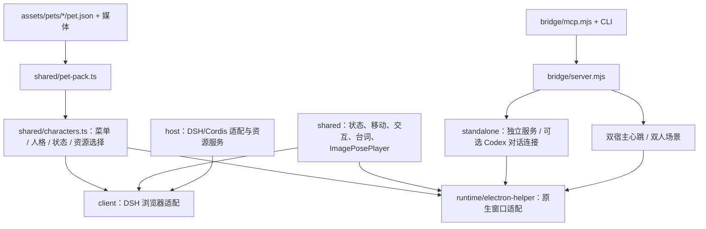

# 架构与边界

本次从屏幕合并仓库提交 `73c2178892b4840b78e8b373f29e171872a93e24` 提取桌宠功能，采用独立仓库历史和独立运行目录。

## 分层

| 目录 | 责任 | 不应包含 |
| --- | --- | --- |
| `assets/pets` | 每个角色的人格、动作、状态、媒体；双人场景元数据 | 业务代码、账户、宿主进程逻辑 |
| `src/shared` | 角色接口、交互状态、运动、菜单、台词与静态图片播放器 | DSH 服务实例、文件读写、设备协议 |
| `src/client` | 浏览器 DOM 与 DSH UI 绑定 | 原生窗口 API |
| `src/host` | DSH 配置、资源路由、桌面 helper 生命周期 | 角色专属渲染分支 |
| `src/standalone` | 独立服务与可选对话连接 | 设备输出 |
| `runtime/electron-helper` | 透明窗口、鼠标穿透、桌面定位、原生渲染 | USB、帧传输 |
| `bridge` | 本地控制、会话租约、心跳、双人仲裁、子进程管理 | 图像/视频逐帧编码、模型凭据副本 |
| `art-source` | 动作类型、prompts、旧动作映射、资源哈希 | 运行时状态 |

`src/shared/index.ts` 是浏览器/原生适配共同使用的导出面；`scripts/build-desktop-core.mjs` 将其编译成原生 renderer 的 `shared-core.js`。生成文件随仓库发布，源码是唯一修改入口。

## 角色与媒体的接口

三个现有角色均注册为 PetPack。角色识别不再依赖固定三项的 union 或独立人格表；添加角色会进入同一菜单、资源路由与状态解析。保留少量兼容导出和大肥鱼原有自定义动作目录行为，避免改变已有引擎事件。

`ImagePosePlayer` 只读取一张图或图集中的一格，绘制一次到透明 canvas。计时负责 one-shot 结束、排队切换以及原有移动逻辑；点击缩放、拖拽和窗口移动不等于视频动画。DeepSeek 的 WebM 继续使用原有视频播放器。

## 与屏幕功能的边界

此发布树没有 JONSBO SDK、Python 输出 worker、设备连接/接管路由、帧上报路由、屏幕设置面板或 GIF 解码器。桥接仅处理语义状态，不接收图像帧。默认端口、用户目录、插件标识均与原屏幕版分开。静态图片、播放器和角色接口已同步回原屏幕仓库，原仓库仍保留设备适配。DSH 模块 ID 都为 dsh-pet，因此同一 DSH profile 应选择其中一版。

## 模块化评估

已经明确分开“角色数据 / 共享交互 / 两种 renderer / 两种宿主 / 本地协调”。新增普通角色只需资源与 manifest，新增双人组合只需场景元数据和静态图。这次用新角色注册测试验证了菜单、人格、资源和动作接口。

仍有值得继续拆分的继承代码：`src/host/index.ts` 集中配置、API、服务生命周期，原生 `sprite.js` 与浏览器 `pet.ts` 仍是较大的适配器，原生 `main.js` 集中多显示器、穿透和窗口生命周期。共享层已复用业务规则，但 DOM 与原生窗口事件没有强行合并。后续适合先提取 host 路由模块，再分离 renderer 的菜单和输入控制；应保留当前交互回归测试。

目前支持两个宿主通道 `dsh` / `chatgpt`；角色数量可扩展，任意宿主数量和任意数量角色同时组合不在当前接口范围内。不能把“角色扩展”误说成通用插件运行平台。
